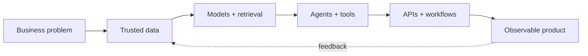

<div align="center">
  

  <br />

  
  
  

  <br />
  <br />

  
</div>

## `> whoami`

I’m **Rishi Siva Kumar**, an **AI/ML Engineer at Credentech Solutions** based in Chennai, India. I design production-minded intelligent systems across **Agentic AI, Generative AI, RAG, machine learning, document intelligence, data engineering, and workflow automation**.

My sweet spot is the full journey from an idea to a dependable product: models and prompts, retrieval and data pipelines, APIs and databases, multi-tenant architecture, human handoff, monitoring, and business workflows.

```text
Understand the problem  →  Ground the intelligence  →  Automate the workflow  →  Ship the product
```

## 🧭 What I build

<table>
  <tr>
    <td align="center" width="25%">
      <strong>🤖 Agentic Systems</strong><br />
      <sub>Tool use · Memory · Sessions · Multi-step orchestration · Human handoff</sub>
    </td>
    <td align="center" width="25%">
      <strong>📚 RAG & Knowledge</strong><br />
      <sub>Tenant-scoped retrieval · Vector search · Enterprise knowledge systems</sub>
    </td>
    <td align="center" width="25%">
      <strong>👁️ Document AI</strong><br />
      <sub>OCR · Layout detection · KYC validation · Financial intelligence</sub>
    </td>
    <td align="center" width="25%">
      <strong>⚙️ AI Products</strong><br />
      <sub>APIs · Data platforms · Voice agents · CRM and workflow automation</sub>
    </td>
  </tr>
</table>

## 🛠️ Technology universe

<div align="center">
  
</div>

<br />

<div align="center">


</div>

<details>
  <summary><strong>More tools I work with</strong></summary>
  <br />
  SQL · REST APIs · NumPy · Pandas · Matplotlib · Seaborn · Keras · Hugging Face Transformers · Tesseract · Power BI · Delta Lake · Azure AI Foundry · M365 Copilot Studio · CI/CD
</details>

## 🚀 Selected builds

### 🤖 Multi-tenant Agentic AI SaaS

Built an enterprise chatbot platform with **FastAPI, PostgreSQL, Redis, and Qdrant**, featuring tenant-scoped RAG, agent memory and sessions, LLM tool workflows, human handoff, queue management, transfers, and supervisor escalation.

### 📞 Voice AI + CRM automation

Built an automated calling platform with **Retell AI, RAG, n8n, and a custom CRM**, connecting lead ingestion, qualification, calls, follow-ups, nudges, scheduling, conversion, and sales tracking into one workflow.

### 🏦 Bank statement intelligence

Developed a financial intelligence platform supporting **40+ Indian banks and 100+ statement formats**, with dynamic format detection, DistilBERT-based transaction enrichment, risk analytics, anomaly detection, and scalable Flask services.

### 🪪 KYC document automation

Designed a unified OCR pipeline for **PAN, Aadhaar, UDYAM, and GST documents** using CNNs, OpenCV, PaddleOCR, LangChain, and MLflow—helping achieve a **45% faster document verification cycle**.

### 📊 Data and ML platforms

Engineered Databricks, PySpark, and SQL pipelines; built lender eligibility and offer-generation models; and improved pipeline execution time by **approximately 35%** through caching, schema pruning, and Spark tuning.

## 🧩 How I think about AI systems



## 🎓 Education

- **Indian Institute of Technology Madras** — B.Sc. Data Science and Programming, currently pursuing via distance learning
- **University of Strathclyde, Glasgow** — B.Sc. Mathematics and Computer Science

## 🤝 Let’s connect

<div align="center">
  <a href="mailto:rishiskumar11@gmail.com">
    
  </a>
  <a href="https://github.com/CRYO-MANCER">
    
  </a>
</div>

<br />

<div align="center">
  <sub>⚡ Building where AI reasoning meets reliable software and real business workflows.</sub>
</div>
