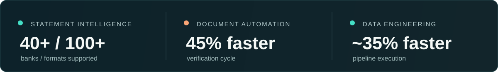
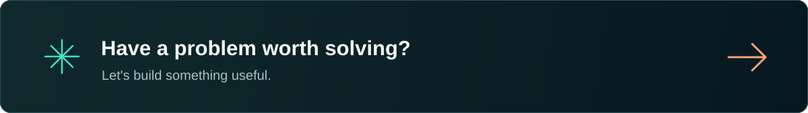

  

   
   

  
  

   

  

## Hello, I'm Rishi 👋

I'm an **AI/ML Engineer** turning complex ideas into working products. I work across agentic AI, generative AI, data engineering, machine learning, computer vision, and the APIs and workflows that bring them together.

I like the part where a clever model becomes a useful system: grounded in the right data, connected to real tools, and built to handle the messy paths between a question and an outcome.

  

## Things I've built 🚀

- **🤖 Multi-tenant AI assistant** 
  Agent orchestration, tenant-scoped RAG, memory, tool workflows, human handoff, routing, queues, and supervisor escalation. Built with FastAPI, PostgreSQL, Redis, and Qdrant.

- **📞 Voice AI + CRM automation** 
  Retell AI agents and n8n workflows connect lead ingestion, qualification, outbound calls, follow-ups, and CRM updates.

- **🏦 Bank statement intelligence** 
  Dynamic parsing across 40+ Indian banks and 100+ statement formats, with transaction enrichment, risk analytics, and anomaly detection.

- **👁️ KYC document intelligence** 
  OCR and validation for PAN, Aadhaar, UDYAM, and GST documents using CNNs, OpenCV, PaddleOCR, LangChain, and MLflow.

  
<strong>Explore more work ↗</strong>

   

  - **Lender offer and eligibility models:** XGBoost and ensemble models, feature engineering, MLflow experiment tracking, and deployment through Databricks and Azure Function Apps.
  - **Data engineering:** Databricks, PySpark, Delta Lake, and SQL pipelines with data quality checks and workflow automation.
  - **Email deliverability intelligence:** Syntax, DNS/MX, SMTP, and RCPT-TO checks with asynchronous bounce tracking through webhooks.
  - **Conversational workflows:** Multi-step financial product journeys with intent detection, RAG, context management, and validation checkpoints.

## How it comes together ✦

  

 

The interesting work lives between the boxes: choosing trustworthy inputs, making tool calls safe, keeping context useful, and turning a model's output into an actual workflow.

## The toolkit 🧰

The everyday stack, at a glance:

  

<em>Open a lane to explore the rest ↓</em>

  
<strong>01 / Languages, web & UI</strong>

   

  
  
  
  
  
  
  
  
  
  
  
  
  

   `Chainlit` ·  `SQL`

  
<strong>02 / Models, ML & foundation models</strong>

   

  
  
  
  
  
  
  
  
  
  
  

   `GPT / OpenAI` ·  `XGBoost`

  *From feature engineering and evaluation to fine-tuning, optimization, and production inference.*

  
<strong>03 / Agents, orchestration & knowledge</strong>

   

  
  
  
  
  
  

   `AutoGen` ·  `MCP servers & clients` ·  `Pinecone`

  *RAG, hybrid and semantic search, embeddings, reranking, agent memory, tool calling, guardrails, and human handoff.*

  
<strong>04 / Document, vision & voice AI</strong>

   

  
  
  
  

   `Tesseract` ·  `Whisper` ·  `Web Speech API` ·  `Retell AI`

  *OCR, PDF parsing, image processing, object detection, speech-to-text, text-to-speech, and real-time voice.*

  
<strong>05 / APIs, databases & data engineering</strong>

   

  
  
  
  
  
  
  
  
  

   `Delta Lake` ·  `Azure Data Factory`

  *REST APIs, WebSockets, SSE, webhooks, asynchronous services, ETL, and data quality pipelines.*

  
<strong>06 / Cloud, deployment & integrations</strong>

   

  
  
  
  

   `Azure / Azure OpenAI` ·  `Azure Functions` ·  `Azure Container Registry` ·  `Azure Storage` ·  `Azure App Service`

  *CI/CD, model serving, observability, secure API integration, SMTP/DNS/MX validation, and production reliability.*

## Off the keyboard 🎓

- **IIT Madras** · B.Sc. Data Science and Programming
- **University of Strathclyde** · B.Sc. Mathematics and Computer Science

  

   

  
  

